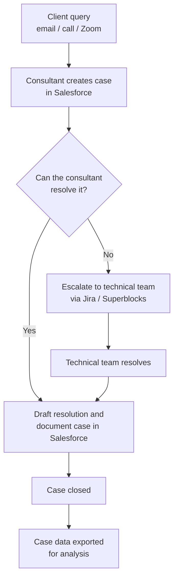
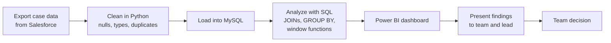

# Support Case Analytics — Business Requirements & Process Documentation

**Author:** Prachi Jain
**Project type:** Business analysis + data analytics
**Tools:** Salesforce (source data), Python (cleaning), MySQL (analysis), Power BI (reporting), Jira (escalations)
**Related work:** [Ticket Forecasting](https://github.com/prac1312hi/Ticket-Forecasting)

> Note: This document describes an analysis of my team's support-case data. No client names, case details or real case volumes are shared here. Any figures shown are illustrative or indexed.

---

## 1. Problem Statement

Our support team handles client queries over several channels: email, inbound calls, outbound calls and Zoom. Every query is logged as a case in Salesforce. Some cases are escalated to the technical team through Jira and Superblocks.

The team lead had no single view of:
- how many cases come in and get closed over time
- which channels close cases most effectively
- how case volume and closure differ by month

Without this view, choosing where the team should spend its time came down to instinct rather than data.

**Business question:** *Which ways of working help the team close more cases, and how should the team plan its time?*

---

## 2. Stakeholders

| Stakeholder | Role | What they need |
|---|---|---|
| Team Lead | Decision maker | Clear view of case trends and channel performance to plan team time |
| Product Consultants (team members) | End users | Visibility into their own case handling and response times |
| Technical Team | Downstream team | Fewer avoidable escalations; well-documented Jira tickets |
| Me (analyst) | Requirement owner and builder | Clean, trustworthy data and agreed definitions of metrics |

---

## 3. Scope

**In scope**
- Salesforce case data for my team, Dec 2024 – Oct 2026
- Case volume, closure and channel analysis
- A Power BI dashboard for the team lead and team
- A recommendation based on the findings

**Out of scope**
- Data from other teams or regions
- Client-level or individual-case analysis
- Live, automated data refresh from Salesforce (data was exported manually)

---

## 4. User Stories & Acceptance Criteria

**US-1 — Cases closed by channel**
> **As a** team lead, **I want** to see how many cases each channel (email, inbound call, outbound call, Zoom) closes each month, **so that** I can decide where the team should focus its time.

*Acceptance criteria:*
- Dashboard shows cases closed per channel, by month
- Can filter by date range
- Totals match the cleaned source data

**US-2 — Case volume trend**
> **As a** team lead, **I want** to see how many cases are created and closed each month, **so that** I can spot busy periods and backlog building up.

*Acceptance criteria:*
- Line chart of cases created vs. closed per month
- Covers the full period, Dec 2024 – Oct 2026

**US-3 — Top case categories**
> **As a** team lead, **I want** to see which case types come up most often, **so that** I can find common issues and training needs.

*Acceptance criteria:*
- Categories ranked by case count (built using a ranking window function in SQL)
- Top categories visible at a glance on the dashboard

**US-4 — Own response time**
> **As a** product consultant, **I want** to see my first response time on cases, **so that** I know where I can improve.

*Acceptance criteria:*
- Shows average first response time for a selected period
- Can be filtered by month

**US-5 — Escalation visibility**
> **As a** team lead, **I want** to see how many cases were escalated to the technical team, **so that** I can track how much work goes to engineering.

*Acceptance criteria:*
- Shows count and share of escalated cases per month

**US-6 — Staffing forecast**
> **As a** team lead, **I want** a monthly forecast of incoming cases, **so that** I can plan team capacity ahead of time.

*Acceptance criteria:*
- Forecast for upcoming months, tested against past data (see the Ticket Forecasting project)

> ✏️ *To do before publishing:* keep only the stories the dashboard actually covers, and edit any that don't match what you built.

---

## 5. Current Process Flow (Case Lifecycle)

## 6. Analysis Process Flow

---

## 7. Data Requirements

| Field | Description | Used for |
|---|---|---|
| Case ID | Unique case identifier | Counting cases |
| Created date | When the case was opened | Volume trends, forecasting |
| Closed date | When the case was closed | Closure trends |
| Channel / origin | Email, inbound call, outbound call, Zoom | Channel performance (US-1) |
| Case category | Type of query | Top categories (US-3) |
| Status | Open / closed / escalated | Escalation tracking (US-5) |
| Owner | Consultant handling the case | Individual views (US-4) |
| First response time | Time to first reply | Response time (US-4) |

> ✏️ *Check:* edit this table to match the exact fields in your export.

**Data quality steps:** removed nulls, fixed data types (dates, text), removed duplicates, standardized channel names.

---

## 8. Findings & Outcome

- **Key finding:** Inbound calls close the most cases of any channel.
- **Recommendation shared:** I presented the dashboard and findings to the team and team lead.
- **Business outcome:** The team now has a **dedicated 2-hour daily inbound-call block** to improve case closure.

---

## 9. Success Criteria

| Goal | How it's measured |
|---|---|
| Team lead can see case trends without manual work | Dashboard covers US-1 to US-5 |
| Data-backed decision on team time | Decision made and adopted (inbound-call block) |
| Better case closure | Closure rate before vs. after the inbound-call block |

> ✏️ *Next step:* once there are a few months of data after the change, add the before/after closure rate (as a % or indexed) here. That gives the project a measured result.

---

## 10. What I Learned

- Agreeing on metric definitions (for example, what counts as "closed") with stakeholders before building saves rework.
- Writing requirements as user stories keeps the dashboard focused on decisions, not just charts.
- A simple finding, presented clearly, can change how a team works.
